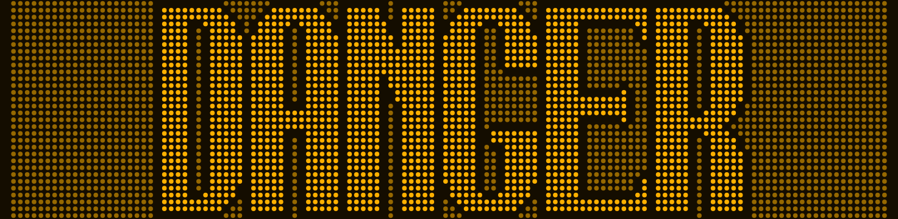
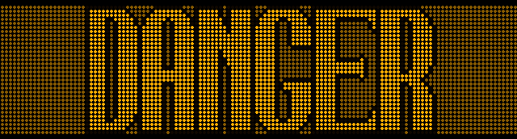
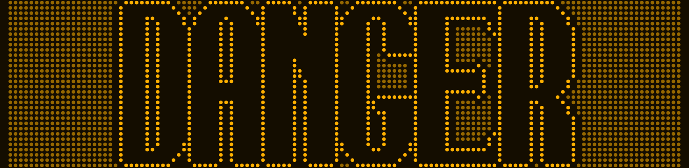
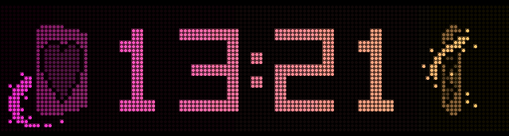
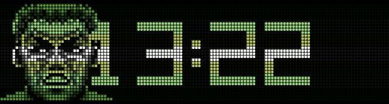
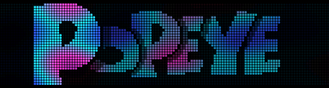

# DMDClock

DMDClock is a classic pinball dot-matrix-display clock. It can run on a Windows
or macOS computer, or directly on a supported Waveshare ESP32-S3 display. Add a
scene library to alternate animated pinball scenes with the clock.

**Latest release:** [GitHub Releases](https://github.com/DrWize/DMD-Pinball-Clock-Win-x64-and-ESP32/releases/latest)

## Choose your platform

| Platform | Status |
| --- | --- |
| Windows 11 | Supported |
| ESP32-S3-Touch-LCD-7 (800x480, N16R8) | Supported |
| ESP32-S3-Touch-LCD-3.49B V2 / Rev1.1 (640x172, N16R8) | Supported |
| macOS Apple Silicon | Unsigned developer preview |

## Windows quick start

1. Download the Windows package from the latest release.
2. Run the setup EXE, or extract the standalone ZIP to a folder you can write to.
3. Start `DmdClock.App.exe`.
4. Open settings to select a scene folder, choose the clock/font/colours, and
   decide how scenes alternate with the clock.

The app works as a clock without any scenes. Settings and logs are stored in
`%LOCALAPPDATA%\DmdClock`, not beside the executable.

See the [Windows guide](docs/WINDOWS.md) for setup, playback, diagnostics, and recovery.

## ESP32-S3 quick start

You need a FAT32 microSD card (256 MB or larger), card reader, USB-C data cable,
a supported board, Windows 11, and PowerShell 7.

1. Download the current `RUNME-Install-DmdClockEsp32.ps1` from the latest
   release and run it from a clean folder:

   ```powershell
   Unblock-File .\RUNME-Install-DmdClockEsp32.ps1
   .\RUNME-Install-DmdClockEsp32.ps1 -CheckRequirements
   .\RUNME-Install-DmdClockEsp32.ps1 -Wizard
   ```

2. Let the wizard prepare the card, insert it while the board is powered off,
   then select the board and its verified UART COM port for flashing.
3. Accept the optional **Configure home Wi-Fi over COM** prompt after flashing,
   or choose **[7] Configure Wi-Fi only** in the installer menu. You can also
   join its Wi-Fi access point and use the local web setup.
4. Open the clock's web address to set time zone, display preferences, and scene library.

See [flash and COM Wi-Fi setup](docs/ESP32-FLASH-AND-WIFI.md) for commands and recovery.

Use `-WhatIf` to preview an operation. `-DownloadOnly` stages the library,
firmware, and flasher without a card or board. Never select a disk number until
you have confirmed it is the intended removable card.

## macOS quick start

> **Developer preview:** the Apple Silicon app is unsigned and not notarized.
> Gatekeeper will require an explicit first-launch confirmation.

1. Download the unsigned macOS package from [v1.7.2](https://github.com/DrWize/DMD-Pinball-Clock-Win-x64-and-ESP32/releases/tag/v1.7.2).
2. Move `DMDClock.app` to `Applications`.
3. Control-click the app, choose **Open**, then confirm **Open** in Gatekeeper.

Settings are stored in `~/Library/Application Support/DmdClock`. Do not treat
this preview as a signed public macOS release.

## Scene libraries

| Library | Scenes | Notes |
| --- | ---: | --- |
| DMD-Large | 2,416 | Recommended extended library |
| DotCLK-Orig | 2,324 | Original DotClk collection |

`scene-metadata.json` is supplied with the application and prepared ESP32 card.
Unknown or custom `.scn` files still play; they use their filename when no
verified metadata exists.

## Help and project status

- [Developer guide](docs/development/README.md) — builds, advanced recovery,
  hardware, formats, and release maintenance.
- [Project status](STATUS.md) — verified completed work, open blockers, and
  prioritized next steps.
- [Current TODO](TODO.md) — completed v1.9.0 work and remaining priorities.
- [v1.9.0 release notes](docs/development/RELEASE-NOTES-v1.9.0.md).
- [Historical documentation](docs/legacy/) — preserved guides, release notes,
  design notes, and earlier plans.

Original DotClk resources and related scene formats are credited to
[sigmafx/DotClk-Resources](https://github.com/sigmafx/DotClk-Resources).

## Aligned scene brightness

v1.9.0 applies the same verified whole-scene level mapping on Windows and ESP32.
For `LAST_ACTION_HERO_010.scn`, source values **0, 10, 15** map to **0, 128, 255**
in metadata and **0, 8, 15** in each platform's 16-level renderer.

These fresh captures use Amber (preset 16), 100% overall brightness, and no glow
or hot core. Windows images come from its authenticated capture API. The ESP32
image is a 640x172 QEMU framebuffer capture of the production 3.49B renderer;
it is not a panel photograph. Dot geometry and colour precision differ between
platforms; the scene-level mapping is shared.

| Windows — frame 1 | ESP32 3.49B renderer — frame 1 |
| --- | --- |
|  |  |



[Capture settings and scene identity](docs/screenshots/v1.9.0/capture-info.json).
The source SCN is unchanged; mapping remains consistent across both frames.

## ESP32 colour examples

These Landscape 3.49B (640x172) QEMU captures use 100% brightness. Scene
artwork changes with the selected scene; the examples demonstrate colour
settings rather than fixed scenes.

| Basic | Gradient |
| --- | --- |
|  |  |
| Classic orange — preset 0 | Neon sunset — preset 4 |

| Raster | Plasma |
| --- | --- |
|  |  |
| Green halo — preset 25 | Neon pulse — preset 2 |
